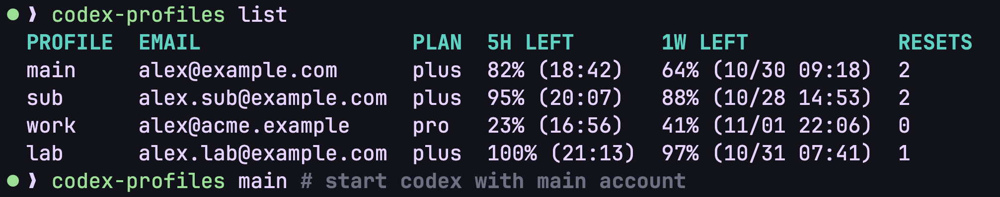

<div align="center">

<h1>Codex Profiles</h1>

<p>English · <a href="README.ja.md">日本語</a> · <a href="README.zh-CN.md">简体中文</a></p>

<p>
Use Codex CLI with multiple ChatGPT accounts.<br>
Run accounts side by side and check their remaining usage limits in one place.<br>
Session history is shared automatically with Codex Desktop, so you can pick up a session with another account.
</p>

<p>
  <a href="https://github.com/kazuki-kanaya/codex-profiles/actions/workflows/ci.yaml"></a>
  <a href="https://github.com/kazuki-kanaya/codex-profiles/releases"></a>
  <a href="LICENSE"></a>
</p>

<p>
  <a href="#installation">Installation</a> ·
  <a href="#usage">Usage</a> ·
  <a href="#how-it-works">How it works</a>
</p>

</div>



## Installation

Install Codex CLI first and make sure `codex` is on your PATH.
Binaries are available for macOS and Linux on arm64 and amd64.

```sh
curl -fsSL https://raw.githubusercontent.com/kazuki-kanaya/codex-profiles/main/install.sh | sh
```

The installer places the binary in `~/.local/bin`. If that directory is not on your PATH, it adds an entry to `~/.zshrc` for zsh or `~/.bashrc` for bash. Run the printed `source` command or open a new terminal.

Run the same command to update. Set `INSTALL_DIR` to choose a different location.

<details>
<summary>Install with Go or Homebrew</summary>

With Go 1.27.3 or later:

```sh
go install github.com/kazuki-kanaya/codex-profiles@latest
```

Make sure `GOBIN`, or `$(go env GOPATH)/bin` if unset, is on your PATH.

With Homebrew:

```sh
brew install --cask kazuki-kanaya/tap/codex-profiles
```

</details>

> The macOS binaries are not notarized by Apple. If macOS blocks the app, verify where you downloaded it from, then allow it under **System Settings → Privacy & Security → Open Anyway**.

## Usage

Give each account a profile name. `add` starts the Codex login flow.

```sh
codex-profiles add main
codex-profiles add work
codex-profiles list
```

Launch Codex by profile name. Use separate terminals to run accounts at the same time.

```sh
codex-profiles main    # Terminal 1
codex-profiles work    # Terminal 2
```

Arguments after the profile name are passed directly to Codex.

```sh
codex-profiles work resume <SESSION_ID>
```

For a shorter command, add an alias to your shell configuration:

```sh
alias cdx='codex-profiles'
```

### Commands

| Command | Description |
| --- | --- |
| `add NAME` | Create a profile and log in |
| `list` | Show accounts and remaining usage limits |
| `NAME [args...]` | Run Codex with the selected account |
| `rename OLD NEW` | Rename a profile |
| `remove NAME` | Remove a profile |
| `version` / `--version` | Print the version |
| `help` | Show help |

Reset times in `list` use your local time zone. Unavailable values are shown as `-`.

Profile names must start with a lowercase letter and may contain lowercase letters, digits, `-`, and `_`. Command names are reserved.

## How it works

Adding an account creates a separate `CODEX_HOME` and links to the shared session directories. Session sharing works out of the box. Codex handles authentication and token refresh; Desktop credentials and settings are left unchanged.

```text
~/.codex-profiles/
├── main/
│   ├── auth.json
│   ├── config.toml
│   ├── sessions/ -> ~/.codex/sessions/
│   └── archived_sessions/ -> ~/.codex/archived_sessions/
└── work/
    └── ...
```

Only `sessions/` and `archived_sessions/` are shared. SQLite databases and daemon state are kept separate for each account.

Do not update the same session from multiple Codex processes at once. Session lists may differ between clients, so use a session ID when resuming. Compatibility with `/fork`, `/side`, and session history formats depends on your Codex version.

<details>
<summary>Customize storage locations</summary>

Override these environment variables if needed. The defaults work without configuration.

| Environment variable | Default |
| --- | --- |
| `CODEX_PROFILES_HOME` | `~/.codex-profiles` |
| `CODEX_PROFILES_SESSIONS_DIR` | `~/.codex/sessions` |
| `CODEX_PROFILES_ARCHIVED_SESSIONS_DIR` | `~/.codex/archived_sessions` |

Changing these values does not move existing data or update links. Keep profile storage and shared history outside each other's directory trees. Leave `CODEX_SQLITE_HOME` unset to keep SQLite databases separate.

</details>

## Renaming and removing profiles

Close Codex processes using the account first. After confirmation, the tool stops its daemon automatically and aborts if the daemon cannot be stopped. Shared session files are not deleted.

`rename` transfers only `auth.json` and `config.toml`. SQLite databases, logs, and other runtime files are recreated as needed. Save any other profile-specific files before renaming. If `archived_sessions/` is a regular directory rather than a link, migrate its contents to the shared location first.

## License

[MIT](LICENSE)
